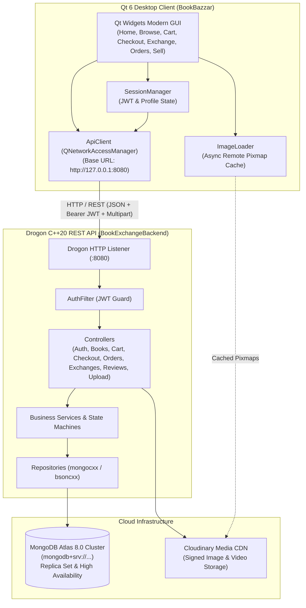

# BookBazzar — Peer-to-Peer Book Marketplace & Barter Exchange Platform

[](https://en.wikipedia.org/wiki/C%2B%2B20)
[](https://www.qt.io/)
[](https://github.com/drogonframework/drogon)
[](https://www.mongodb.com/atlas)
[](https://cloudinary.com/)
[](https://cmake.org/)
[](LICENSE)

An end-to-end, high-performance full-stack C++ peer-to-peer book marketplace and direct physical barter exchange platform. **BookBazzar** enables college students and book enthusiasts to purchase pre-owned books, sell personal collections with cloud-hosted photo/video walkthroughs, or atomically swap physical books directly with peers without monetary transactions.

---

## 📑 Quick Navigation
- [What BookBazzar Provides](#-what-bookbazzar-provides)
- [System Architecture & Cloud Flow](#-system-architecture--cloud-flow)
- [Repository Structure](#-repository-structure)
- [Technology Stack](#-technology-stack)
- [Quick Start Guide](#-quick-start-guide)
- [REST API Specifications](#-rest-api-specifications)
- [Automated Testing & QA Verification](#-automated-testing--qa-verification)
- [Future Implementations Roadmap](#-future-implementations-roadmap)

---

## 🌟 What BookBazzar Provides

BookBazzar is engineered as a production-grade full-stack C++ application combining a modern asynchronous REST API backend with an intuitive, native desktop graphical interface:

### 🛒 1. Cash-Based Marketplace (Buy & Sell)
- **Book Discovery & Instant Search**: High-speed text search across titles, authors, and ISBNs with dynamic filters for condition (`New`, `Like New`, `Very Good`, `Good`, `Acceptable`), category, and price range.
- **Form-Driven Selling with Cloud Media**: Sellers list books with high-resolution cover photos and condition video previews uploaded directly to **Cloudinary CDN** with automatic signed REST authentication.
- **Persistent Shopping Cart**: Real-time server-synced cart with single-copy inventory clamping and automatic stale-item detection if another buyer checks out first.
- **Atomic Checkout & Simulated Payments**: Race-condition-free purchase locking preventing double-buys; simulated instant payments (`UPI`, `CARD`, `COD`) with ₹0 shipping.

### 🔄 2. Direct Peer-to-Peer Barter Book Exchange
- **Zero-Money Book Swapping**: Propose swapping any owned book for another user's listing.
- **Two-Sided Atomic Ownership Transfer**: When the recipient accepts an exchange, book ownership is atomically transferred in MongoDB, listings are removed from public search, and transaction histories are logged.
- **Conflict Prevention**: If a book proposed for exchange is concurrently purchased in the marketplace, the exchange is cleanly aborted with HTTP `409 Conflict` to guarantee data consistency.

### 📦 3. Post-Purchase Fulfillment, Returns & Cancellations
- **Delivery Lifecycle Tracking**: Live progression from `PLACED` → `CONFIRMED` → `PACKED` → `SHIPPED` → `OUT_FOR_DELIVERY` → `DELIVERED` with tracking numbers.
- **Pre-Shipment Cancellation**: Buyers can cancel orders before dispatch to receive instant simulated refunds and immediately restore physical book availability.
- **Post-Delivery Return Flow**: Buyers can request returns with structured reasons; sellers can approve or reject return requests.

### ⭐ 4. Verified Purchase Ratings & Reviews
- **Verified Buyers Only**: Reviews can only be submitted after an order has reached `DELIVERED` status.
- **Real-Time Aggregate Ratings**: Dynamic calculation of average ratings (1 to 5 stars) and review counts for every listing.
- **Privacy Controls**: Public review streams preserve buyer privacy by scrubbing sensitive order and payment metadata.

### 🔒 5. Production-Grade Security
- **Argon2id Password Hashing**: State-of-the-art memory-hard hashing with OpenSSL CSPRNG cryptographic salting.
- **Dual-Token Authentication**: Short-lived HS256 JWT access tokens paired with rotating SHA-256 refresh tokens.
- **In-Depth IDOR Authorization**: Strict server-side ownership verification preventing unauthorized updates or deletions.

---

## 🏛️ System Architecture & Cloud Flow



---

## 📁 Repository Structure

```
.
├── backend/                            # C++20 Drogon REST API Backend
│   ├── CMakeLists.txt                  # vcpkg-integrated build configuration
│   ├── vcpkg.json                      # Manifest (drogon, mongocxx, argon2, jwt-cpp, jsoncpp)
│   ├── config.json                     # Drogon server listener & thread settings
│   ├── .env.example                    # Environment variable template (Atlas & Cloudinary)
│   ├── include/                        # C++ architecture headers
│   │   ├── config/AppConfig.h          # Environment & configuration loader (Singleton)
│   │   ├── db/MongoDatabase.h          # MongoDB client manager & automated index creator
│   │   ├── controllers/                # REST Controllers (Auth, Book, Cart, Order, Exchange, Review, Upload)
│   │   ├── models/                     # Domain structs (Book, User, Cart, Order, Exchange, Review)
│   │   ├── repositories/               # Mongo data access layer using mongocxx
│   │   ├── security/                   # Argon2id, JWT, and Payment services
│   │   └── services/                   # Business domain orchestration
│   ├── src/                            # Implementation files matching include/
│   └── tests/                          # Automated backend test suites
│       ├── test_qa_suite.ps1           # Master QA suite (94 tests, 100% pass rate)
│       ├── test_atlas_connection.ps1   # Atlas DNS SRV & TCP connectivity verification
│       ├── test_cloudinary_upload.ps1  # Cloudinary multipart upload & CDN test
│       ├── test_marketplace.ps1        # Phase 1 — Book marketplace (16 tests)
│       ├── test_buy_sell.ps1           # Phase 2 — Cart, checkout & payment (23 tests)
│       ├── test_exchange.ps1           # Phase 3 — Peer-to-peer exchange (24 tests)
│       ├── test_phase4.ps1             # Phase 4 — Reviews, cancel & returns (24 tests)
│       └── BookExchangeBackend.postman_collection.json
│
├── frontend/                           # Qt 6 Desktop Client Application
│   ├── CMakeLists.txt                  # Qt6 CMake build configuration (BookBazzar & Tests)
│   ├── include/                        # Client headers (network, auth, models, windows)
│   ├── src/                            # GUI & network client implementations
│   ├── tests/                          # Automated Qt Test suites (BookBazzarTests & GuiSmokeTest)
│   └── ui/                             # Qt Designer forms (loginwindow.ui)
│
├── future.md                           # Comprehensive production scaling & engineering roadmap
├── start.md                            # Complete startup & execution guide
├── start_backend.bat                   # 1-Click backend server launcher
├── start_mongo.bat                     # Local MongoDB daemon launcher fallback
└── README.md                           # Master project documentation
```

---

## 🛠️ Technology Stack

| Domain | Technology | Version | Purpose |
| :--- | :--- | :---: | :--- |
| **Backend Core** | C++ | ISO C++20 | REST API business logic & concurrency |
| **Backend Framework** | [Drogon](https://github.com/drogonframework/drogon) | 1.9.13 | High-throughput asynchronous non-blocking HTTP server |
| **Cloud Database** | MongoDB Atlas | 7.x / 8.0 | High-availability cloud document store via `mongocxx` 4.4+ |
| **Cloud Media CDN** | Cloudinary | REST API v1.1 | Scalable book cover image & video walkthrough CDN storage |
| **Desktop Client** | Qt Widgets | Qt 6.12.0 / 6.x | Native, responsive desktop GUI with dark-mode styling |
| **Security** | Argon2id + OpenSSL | 3.x | Memory-hard password hashing & CSPRNG cryptographic salting |
| **Tokens** | [jwt-cpp](https://github.com/Thalhammer/jwt-cpp) | 0.7.x | HS256 JWT access tokens & rotating SHA-256 refresh cookies |
| **JSON Serialization** | JsonCpp / QJsonDocument | 1.9.x / Qt 6 | High-speed JSON encode and decode |
| **Package Management** | vcpkg | Manifest Mode | C++ library acquisition and toolchain integration |
| **Build System** | CMake + Ninja | ≥ 3.20 | Cross-platform build generation with AUTOMOC & AUTOUIC |

---

## ⚡ Quick Start Guide

### Option 1: One-Click Startup (Recommended)
1. **Launch the Drogon Backend**:
   - Double-click [`start_backend.bat`](file:///start_backend.bat) (or run `.\start_backend.bat` in PowerShell / terminal).
   - Connects directly to MongoDB and starts listening at `http://127.0.0.1:8080`.
2. **Launch the Qt Desktop Frontend**:
   - Open Qt Creator ➡️ Open `frontend/CMakeLists.txt` ➡️ Press `Ctrl + R`.
   - Alternatively, run from terminal:
     ```cmd
     set PATH=C:\Qt\6.12.0\msvc2022_64\bin;%PATH%
     .\frontend\build\Desktop_Qt_6_12_0_MSVC2022_64bit_Debug\BookBazzar.exe
     ```

### Troubleshooting

| Issue | Cause | Solution |
| :--- | :--- | :--- |
| **"Address already in use (8080)"** | A previous instance of the backend is still running. | Run `Stop-Process -Name BookExchangeBackend -Force` in PowerShell. |
| **"Cannot open config.json"** | Working directory is not `backend/`. | Launch via `start_backend.bat` or `cd backend` first. |
| **"Failed to connect to MongoDB Atlas"** | DNS SRV resolution or outbound port 27017 blocked. | Run `.\backend\tests\test_atlas_connection.ps1` to test connectivity. |
| **"Network Error in Qt GUI"** | Backend server is not running on port 8080. | Launch `start_backend.bat` before performing actions in the GUI. |

---

## 📡 REST API Specifications

All protected endpoints require an `Authorization: Bearer <jwt>` HTTP header.

| Method | Route | Auth | Description |
| :--- | :--- | :---: | :--- |
| `POST` | `/api/auth/signup` | Public | Register new user account with Argon2id password hash |
| `POST` | `/api/auth/login` | Public | Authenticate credentials; return JWT and HttpOnly refresh cookie |
| `POST` | `/api/auth/refresh`| Cookie | Rotate refresh token and issue fresh access token |
| `POST` | `/api/auth/logout` | Bearer | Invalidate active session and revoke refresh cookie |
| `GET` | `/api/auth/me` | Bearer | Retrieve authenticated user profile |
| `GET` | `/api/books` | Public | Browse & search available listings (supports `search`, `category`, `condition`, `minPrice`, `maxPrice`, `sort`, `page`, `limit`) |
| `GET` | `/api/books/:id` | Public | Comprehensive book details with aggregate rating and review count |
| `GET` | `/api/books/my` | Bearer | Retrieve seller's owned inventory (including sold/historical) |
| `POST` | `/api/books` | Bearer | Create a new physical book listing with cover and video URLs |
| `PUT` | `/api/books/:id` | Bearer | Update an owned book listing (title, price, condition) |
| `DELETE` | `/api/books/:id` | Bearer | Soft-delete / delist owned book listing |
| `POST` | `/api/upload` | Public/Bearer | Multipart form upload to Cloudinary CDN (`file` field). Returns `{ success: true, url, public_id }` |
| `GET` | `/api/cart` | Bearer | Fetch persistent cart & verify single-copy availability |
| `POST` | `/api/cart/items` | Bearer | Add book to cart (single-copy quantity guaranteed) |
| `DELETE` | `/api/cart/items/:id`| Bearer | Evict item from cart |
| `POST` | `/api/checkout` | Bearer | Atomic checkout, inventory lock & demo payment simulation |
| `GET` | `/api/orders` | Bearer | List buyer orders & seller fulfillment history |
| `GET` | `/api/orders/:id` | Bearer | Get full order lifecycle, tracking and item details |
| `PATCH` | `/api/orders/:id/status`| Bearer | Advance delivery status (seller only) |
| `POST` | `/api/orders/:id/cancel`| Bearer | Pre-shipping order cancellation & inventory refund |
| `POST` | `/api/orders/:id/return`| Bearer | Request post-delivery item return with structured reason |
| `POST` | `/api/orders/:id/return/process`| Bearer | Seller approval or rejection of return request |
| `POST` | `/api/exchanges` | Bearer | Propose barter exchange (offering owned book for requested book) |
| `GET` | `/api/exchanges/sent` | Bearer | View sent barter proposals |
| `GET` | `/api/exchanges/received`| Bearer | View received barter proposals |
| `POST` | `/api/exchanges/:id/accept`| Bearer | Accept exchange & trigger atomic two-sided ownership swap |
| `POST` | `/api/exchanges/:id/reject`| Bearer | Reject barter proposal (receiver only) |
| `POST` | `/api/exchanges/:id/cancel`| Bearer | Cancel pending barter proposal (requester only) |
| `POST` | `/api/reviews` | Bearer | Submit review for verified DELIVERED purchase (`{ orderId, bookId, rating, comment }`) |
| `GET` | `/api/books/:id/reviews` | Public | View public verified reviews for a book (order ID scrubbed) |
| `GET` | `/api/reviews/my` | Bearer | View reviews written by authenticated user |
| `PUT` | `/api/reviews/:id` | Bearer | Edit rating or comment of own review |
| `DELETE` | `/api/reviews/:id` | Bearer | Delete own review and update book aggregate rating |

For complete backend schema details, view the [Backend README](backend/README.md).

---

## 🧪 Automated Testing & QA Verification

### Backend Automated Test Suite (94 Tests — 100% Pass Rate)
A full-spectrum integration, security, concurrency, and fuzzing suite testing every endpoint against edge cases:
```powershell
powershell -ExecutionPolicy Bypass -File backend/tests/test_qa_suite.ps1
```

```text
================================================================
QA & INTEGRATION TEST RUN COMPLETE
Total Tests:  94
Passed Tests: 94
Failed Tests: 0
================================================================
```

### Cloud Integration Verification Scripts
```powershell
# Verify MongoDB Atlas DNS SRV resolution & TCP connectivity
powershell -ExecutionPolicy Bypass -File backend/tests/test_atlas_connection.ps1

# Verify Cloudinary signed media upload & CDN delivery
powershell -ExecutionPolicy Bypass -File backend/tests/test_cloudinary_upload.ps1
```

### Frontend Unit & GUI Smoke Tests (29 Tests — 100% Pass Rate)
Automated testing powered by **Qt Test (QTest)**:
```cmd
# Run Unit Tests (DataModels, SessionManager, Validation, ApiClient)
.\frontend\build\Desktop_Qt_6_12_0_MSVC2022_64bit_Debug\BookBazzarTests.exe

# Run GUI Smoke Test (Verifies all 12 windows render cleanly)
.\frontend\build\Desktop_Qt_6_12_0_MSVC2022_64bit_Debug\BookBazzarGuiSmokeTest.exe
```

---

## 🚀 Future Implementations Roadmap

For commercial production deployment, scaling to thousands of concurrent users, and real-world compliance, an exhaustive technical roadmap is detailed in:  
👉 **[`future.md`](future.md)**

Key strategic roadmap milestones:
1. **Real Payment Gateways & Escrow Subsystem**: Razorpay / Stripe webhook processing with escrow payout protection.
2. **Third-Party Logistics (3PL)**: Automated AWB generation and live tracking webhooks via Shiprocket / Delhivery.
3. **Real-Time WebSockets**: Instant notifications for order status milestones and barter proposals.
4. **Peer-to-Peer Secure In-App Chat**: Contextual messaging for barter negotiation and condition inquiries.
5. **Computer Vision & ISBN Barcode Scanning**: Instant book metadata extraction via device camera and OpenLibrary API.
6. **Campus & Hyperlocal Meetup Zones**: Zero-cost peer book handover with cryptographic proximity QR verification.
7. **Cross-Platform Mobile Client**: Flutter / React Native mobile applications consuming the Drogon REST API.
8. **Production Infrastructure & Observability**: Multi-stage Docker containers, Kubernetes Helm charts, Redis session caching, Prometheus metrics, and Grafana dashboards.

---

## 📄 Documentation Links

- 📘 [Backend API Architecture & Implementation Guide](backend/README.md)
- 🖥️ [Frontend Qt6 Desktop Client Guide](frontend/README.md)
- 🚀 [Production Scaling & Future Roadmap (`future.md`)](future.md)

---

## 📜 License

This project is licensed under the MIT License — see the [LICENSE](LICENSE) file for details.
