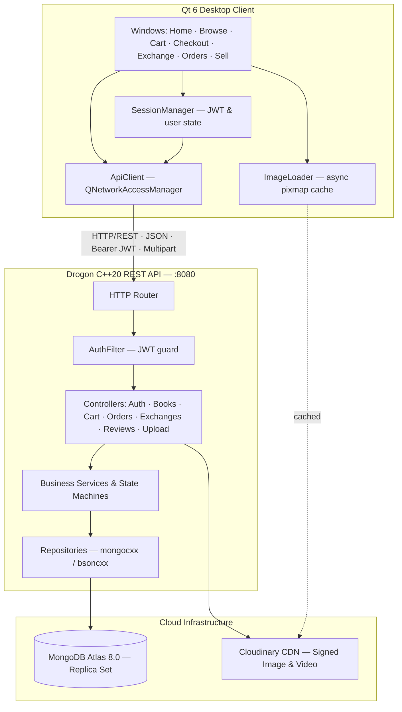

# BookBazzar — Peer-to-Peer Book Marketplace & Barter Exchange Platform

[](https://en.wikipedia.org/wiki/C%2B%2B20)
[](https://www.qt.io/)
[](https://github.com/drogonframework/drogon)
[](https://www.mongodb.com/atlas)
[](https://cloudinary.com/)
[](https://cmake.org/)
[](LICENSE)

A full-stack C++ application enabling college students to buy, sell, and directly barter pre-owned physical books — with cloud media, atomic transactions, and a native desktop GUI.

> **Scope:** Payment and shipping are simulated for demonstration purposes. No real financial transactions or courier integrations are active.

---

## Overview

BookBazzar is a monorepo with two coupled components:

| Component | Description |
| :--- | :--- |
| [`backend/`](backend/README.md) | C++20 Drogon REST API — auth, listings, cart, checkout, orders, exchanges, reviews, media upload |
| [`frontend/`](frontend/README.md) | Qt 6 desktop client — dark-mode GUI, async networking, Cloudinary integration |

**Core features:**

- **Marketplace** — browse, search, filter, and purchase single-copy pre-owned books; atomic checkout prevents double-buys
- **Barter Exchange** — propose and atomically execute zero-money peer-to-peer book swaps
- **Order Lifecycle** — `PLACED → DELIVERED` tracking, pre-shipment cancellation, post-delivery returns
- **Reviews** — verified purchase reviews gated behind `DELIVERED` status
- **Security** — Argon2id hashing, dual-token JWT/refresh auth, IDOR-protected routes

---

## Architecture



---

## Repository Structure

```
.
├── backend/                    # C++20 Drogon REST API
│   ├── CMakeLists.txt          # vcpkg-integrated build
│   ├── vcpkg.json              # drogon, mongocxx, argon2, jwt-cpp, jsoncpp
│   ├── config.json             # Drogon listener & thread config
│   ├── .env.example            # Required environment variables
│   ├── include/
│   │   ├── config/             # AppConfig — env loader singleton
│   │   ├── db/                 # MongoDatabase — client & index manager
│   │   ├── filters/            # AuthFilter — JWT middleware
│   │   ├── security/           # Argon2id · JWT · PaymentService
│   │   ├── models/             # Book, User, Cart, Order, Exchange, Review
│   │   ├── repositories/       # mongocxx data access layer
│   │   ├── services/           # Business logic & orchestration
│   │   └── controllers/        # Drogon HTTP controllers
│   ├── src/                    # Implementations
│   └── tests/                  # PowerShell integration suites & Postman collection
│
├── frontend/                   # Qt 6 Desktop Client
│   ├── CMakeLists.txt          # Qt6 + AUTOMOC/AUTOUIC build
│   ├── include/                # Headers: auth, common, models, network, windows
│   ├── src/                    # Implementations: auth, common, network, windows
│   ├── tests/                  # Qt Test suites
│   └── ui/                     # Qt Designer .ui forms
│
├── future.md                   # Production scaling roadmap
├── start_backend.bat           # One-click backend launcher
└── README.md
```

---

## Tech Stack

| Layer | Technology | Version |
| :--- | :--- | :---: |
| Backend language | C++ | ISO C++20 |
| HTTP framework | [Drogon](https://github.com/drogonframework/drogon) | 1.9.13 |
| Database | MongoDB Atlas — mongocxx | 8.0 |
| Media CDN | Cloudinary | REST v1.1 |
| Desktop client | Qt Widgets | 6.12.0 |
| Password hashing | Argon2id + OpenSSL | 3.x |
| Auth tokens | jwt-cpp — HS256 + SHA-256 refresh | 0.7.x |
| Serialization | JsonCpp / QJsonDocument | 1.9.x / Qt 6 |
| Package manager | vcpkg manifest mode | — |
| Build system | CMake + Ninja | ≥ 3.20 |

---

## Quick Start

### 1. Start the Backend

```powershell
# Recommended — sets all required env vars automatically
.\start_backend.bat
```

Or manually from `backend/`:

```powershell
$env:JWT_SECRET            = "your-high-entropy-secret"
$env:MONGO_URI             = "mongodb+srv://..."      # or mongodb://127.0.0.1:27017
$env:MONGO_DATABASE        = "book_exchange"
$env:CLOUDINARY_CLOUD_NAME = "your-cloud-name"
$env:CLOUDINARY_API_KEY    = "your-api-key"
$env:CLOUDINARY_API_SECRET = "your-api-secret"
.\build\Debug\BookExchangeBackend.exe
```

### 2. Start the Frontend

**Qt Creator (recommended):** Open `frontend/CMakeLists.txt` → select Qt 6 kit → `Ctrl+R`

**Terminal:**
```cmd
set PATH=C:\Qt\6.12.0\msvc2022_64\bin;%PATH%
.\frontend\build\Desktop_Qt_6_12_0_MSVC2022_64bit_Debug\BookBazzar.exe
```

---

## Documentation

| File | Contents |
| :--- | :--- |
| [backend/README.md](backend/README.md) | API reference, database schema, env config, build guide |
| [frontend/README.md](frontend/README.md) | UI architecture, window catalog, build & run instructions |
| [future.md](future.md) | Production scaling roadmap — payments, logistics, WebSockets, mobile |

---

## License

MIT — see [LICENSE](LICENSE).