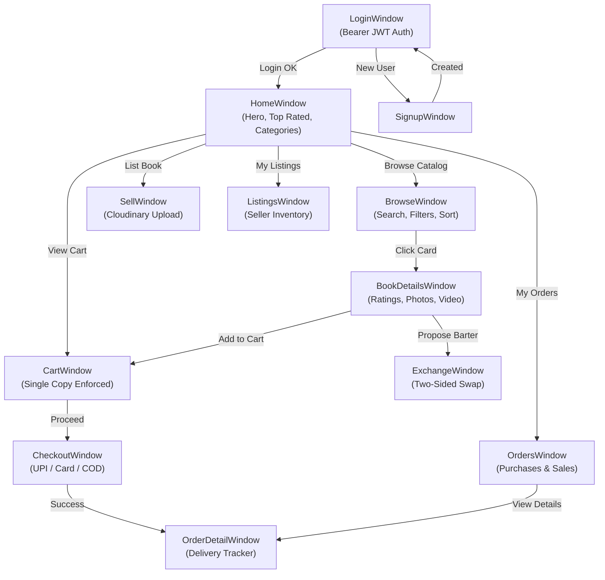

# BookBazzar — Qt6 Desktop Client

[](https://en.wikipedia.org/wiki/C%2B%2B17)
[](https://www.qt.io/)
[](https://cmake.org/)
[](../backend/README.md)
[](https://cloudinary.com/)

A modern, high-performance desktop client engineered in **C++17** and **Qt 6 Widgets**. BookBazzar provides an intuitive, responsive graphical user interface for a peer-to-peer book marketplace and barter exchange network, integrating directly with the **Drogon REST API**, **MongoDB Atlas**, and **Cloudinary CDN**.

---

## 1. Architectural Highlights

The frontend operates as a full-featured desktop client communicating asynchronously over HTTP with the Drogon C++20 backend:

- **Asynchronous REST Network Client (`ApiClient`)**: Non-blocking `QNetworkAccessManager` wrapper with automatic JWT Bearer authentication headers, standardized JSON parsing, and multipart file upload support.
- **Session & Identity Management (`SessionManager`)**: Singleton managing user authentication tokens, expiration tracking, active user profiles, and persistent login states.
- **Cloud Media Ingestion**: Direct integration with `/api/upload` allowing sellers to upload high-resolution book cover images and video condition walkthroughs directly to Cloudinary CDN with live thumbnail caching.
- **Single-Window Navigation Stack**: Fluid page transitions between Home, Browse, Details, Cart, Checkout, Barter Exchanges, and Order History without popup clutter.
- **Modern Design System (`AppStyle`)**: Bespoke dark-mode visual hierarchy with curated HSL color palettes, glassmorphism cards, hover animations, responsive grids, and custom dialogs (`StyledMessageBox`).
- **Comprehensive Automated Testing**: Full QTest-based unit test suite (`BookBazzarTests`) and headless UI smoke test suite (`BookBazzarGuiSmokeTest`).

---

## 2. Tech Stack

| Component | Technology | Version | Purpose |
| :--- | :--- | :--- | :--- |
| **Language** | C++ | ISO C++17 (`/std:c++17`) | Desktop client logic |
| **GUI Framework** | Qt Widgets | Qt 6.12.x / Qt 6.x | Native window rendering, controls, layouts, signals & slots |
| **Network Client** | Qt Network | `QNetworkAccessManager` | Asynchronous REST communication and multipart upload |
| **Data Serialization** | Qt Core | `QJsonDocument`, `QJsonObject` | Type-safe JSON model mapping |
| **Asynchronous Images**| `QNetworkReply` & `QPixmap` | In-memory cache | Non-blocking remote cover art downloading (`ImageLoader`) |
| **Unit Testing** | Qt Test (QTest) | 6.x | Automated unit testing and UI smoke testing |
| **Build System** | CMake + Ninja | CMake ≥ 3.16 | Multi-platform build generation with AUTOMOC & AUTOUIC |

---

## 3. Directory Layout

```
frontend/
├── CMakeLists.txt                  # Build configuration with target BookBazzar & BookBazzarTests
│
├── include/
│   ├── network/
│   │   └── ApiClient.h             # Asynchronous REST HTTP client (Singleton)
│   ├── auth/
│   │   └── SessionManager.h        # Session token, user caching & logout manager
│   ├── models/
│   │   └── DataModels.h            # Type-safe data models (Book, Cart, Order, Exchange, Review)
│   ├── windows/
│   │   ├── CartWindow.h            # Persistent cart window with total & ₹0 shipping calculation
│   │   ├── CheckoutWindow.h        # Atomic checkout modal (UPI, CARD, COD)
│   │   ├── OrderDetailWindow.h     # Detailed delivery timeline tracker & return requests
│   │   └── ExchangeWindow.h        # Two-sided physical barter proposal & acceptance window
│   ├── AppStyle.h                  # Design system tokens, stylesheets & color palettes
│   ├── ImageLoader.h               # Asynchronous remote pixmap caching loader
│   ├── StyledMessageBox.h          # Custom styled notification and alert modals
│   ├── loginwindow.h               # Authenticated login window
│   ├── signupwindow.h              # Account registration window with validation
│   ├── homewindow.h                # Marketplace discovery hub with hero banners & category cards
│   ├── browsewindow.h              # Live catalog with search, price filters & condition tags
│   ├── bookdetailswindow.h         # Comprehensive book view with rating, photos & actions
│   ├── listingswindow.h            # Active inventory management for sellers
│   ├── orderswindow.h              # Unified purchase and sales history
│   └── sellwindow.h                # Form-driven book listing & Cloudinary upload window
│
├── src/                            # C++ implementations matching include/
│   ├── main.cpp                    # Application initialization & login launch
│   ├── network/ApiClient.cpp       # Drogon REST API communication implementation
│   ├── auth/SessionManager.cpp     # JWT and token lifecycle implementation
│   ├── windows/                    # Window implementations (Cart, Checkout, OrderDetail, Exchange)
│   ├── AppStyle.cpp                # Stylesheet generation
│   ├── ImageLoader.cpp             # Network image download & memory cache
│   └── ...                         # UI window implementations
│
├── tests/                          # Automated test harness & test suites
│   ├── main_test.cpp               # Master QTest runner
│   ├── test_datamodels.h/.cpp      # Data model serialization unit tests (12 tests)
│   ├── test_sessionmanager.h/.cpp  # SessionManager token & auth unit tests (6 tests)
│   ├── test_validation.h/.cpp      # Input & format validation unit tests (7 tests)
│   ├── test_apiclient.h/.cpp       # ApiClient URL & header injection tests (4 tests)
│   ├── gui_smoke_test.cpp          # Full automated GUI smoke test (12 windows)
│   └── capture_screens.cpp         # Headless visual verification screenshot generator
│
└── ui/
    └── loginwindow.ui              # Qt Designer layout for login interface
```

---

## 4. UI Flow & Window Architecture



---

## 5. Screen Catalog & Features

### 🛍️ Marketplace & Discovery
- **`HomeWindow`**: Featured books, recent listings, category shortcuts (`Academic`, `Fiction`, `Technology`, `Non-Fiction`, `Novels`), and fast search bar.
- **`BrowseWindow`**: Responsive book card grid with dynamic search filtering by title, author, and ISBN; price range slider; condition tags (`New`, `Like New`, `Good`, `Acceptable`); and sorting options.
- **`BookDetailsWindow`**: High-resolution cover art viewer, condition walkthrough video preview, verified seller rating badges, condition description, and action buttons (`Add to Cart`, `Swap Book`).

### 💳 Cart, Checkout & Fulfillment
- **`CartWindow`**: Real-time server-synced cart with single-copy inventory enforcement, item removal, subtotal calculation, and ₹0 delivery.
- **`CheckoutWindow`**: Shipping address input with regex validation, payment method selector (`UPI`, `Credit/Debit Card`, `Cash on Delivery`), and atomic double-buy prevention.
- **`OrderDetailWindow`**: Live horizontal delivery lifecycle tracker (`PLACED` ➔ `CONFIRMED` ➔ `PACKED` ➔ `SHIPPED` ➔ `OUT_FOR_DELIVERY` ➔ `DELIVERED`), tracking numbers, pre-shipment cancellation, and post-delivery return request form.

### 🔄 Peer-to-Peer Barter Exchange
- **`ExchangeWindow`**: Dual-panel barter interface showing user's owned books alongside the target book. Allows sending barter proposals with custom notes, viewing received offers, accepting swaps, or rejecting requests.

### 📸 Seller Form & Cloud Media Upload
- **`SellWindow`**: Input fields for Title, Author, ISBN, Price, Category, and Condition. Includes native Windows file picker for cover photos and videos, instantly uploading files to Cloudinary CDN via `/api/upload` and populating CDN asset URLs before submitting the listing.

---

## 6. Build & Execution Guide

### Prerequisites
- Windows 10/11 64-bit
- **Qt 6.12.0** (or Qt 6.x) with Widgets and Network components installed
- **Visual Studio 2022 C++ Build Tools** or MinGW 64-bit
- **CMake ≥ 3.16** and **Ninja**

### Building via Command Line (Visual Studio 2022 + Ninja)
```cmd
:: Initialize MSVC 64-bit developer environment
call "C:\Program Files (x86)\Microsoft Visual Studio\2022\BuildTools\VC\Auxiliary\Build\vcvarsall.bat" x64

:: Configure build directory
cmake -S frontend -B frontend/build/Desktop_Qt_6_12_0_MSVC2022_64bit_Debug -G Ninja -DCMAKE_PREFIX_PATH="C:/Qt/6.12.0/msvc2022_64"

:: Compile BookBazzar executable
cmake --build frontend/build/Desktop_Qt_6_12_0_MSVC2022_64bit_Debug --target BookBazzar

:: Run Desktop Client
set PATH=C:\Qt\6.12.0\msvc2022_64\bin;%PATH%
.\frontend\build\Desktop_Qt_6_12_0_MSVC2022_64bit_Debug\BookBazzar.exe
```

### Building via Qt Creator
1. Open Qt Creator ➡️ Select **Open File or Project...** ➡️ Open `frontend/CMakeLists.txt`.
2. Configure the project with your installed Qt 6 Kit (e.g. `Desktop Qt 6.12.0 MSVC2022 64bit`).
3. Press `Ctrl + B` to build, and `Ctrl + R` to run.

---

## 7. Automated Testing Suite

The frontend includes unit test suites powered by **Qt Test (QTest)**:

### 1. Run Unit Tests (`BookBazzarTests`)
Tests data model JSON serialization, `SessionManager` token lifecycle, input validation routines, and `ApiClient` headers.

```cmd
:: Build test executable
cmake --build frontend/build/Desktop_Qt_6_12_0_MSVC2022_64bit_Debug --target BookBazzarTests

:: Execute all QTest test cases
set PATH=C:\Qt\6.12.0\msvc2022_64\bin;%PATH%
.\frontend\build\Desktop_Qt_6_12_0_MSVC2022_64bit_Debug\BookBazzarTests.exe
```

**Unit Test Coverage**:
- `TestDataModels`: 12 tests validating serialization/deserialization for `BookModel`, `CartModel`, `OrderModel`, `ExchangeOfferModel`, `ReviewModel`, and Cloudinary media fields.
- `TestSessionManager`: 6 tests validating login session storage, token caching, expiration checks, and logout cleanup.
- `TestValidation`: 7 tests validating email regex, password strength, positive pricing, and ISBN formats.
- `TestApiClient`: 4 tests validating singleton instance, base URL formatting, and Bearer token attachment.
- **Result**: 29 passed, 0 failed.

### 2. Run UI Smoke Tests (`BookBazzarGuiSmokeTest`)
Automated GUI smoke test that programmatically instantiates, tests event loops, verifies signal-slot bindings, and navigates across all 12 windows without crashes:
```cmd
cmake --build frontend/build/Desktop_Qt_6_12_0_MSVC2022_64bit_Debug --target BookBazzarGuiSmokeTest
.\frontend\build\Desktop_Qt_6_12_0_MSVC2022_64bit_Debug\BookBazzarGuiSmokeTest.exe
```

---

## 8. Configuration

The frontend communicates with the Drogon REST API backend. The API endpoint is configured in `ApiClient.h`:
- Default Base URL: `http://127.0.0.1:8080` (can be updated for production deployment).

*Authored for the BookBazzar Production Desktop Client.*
