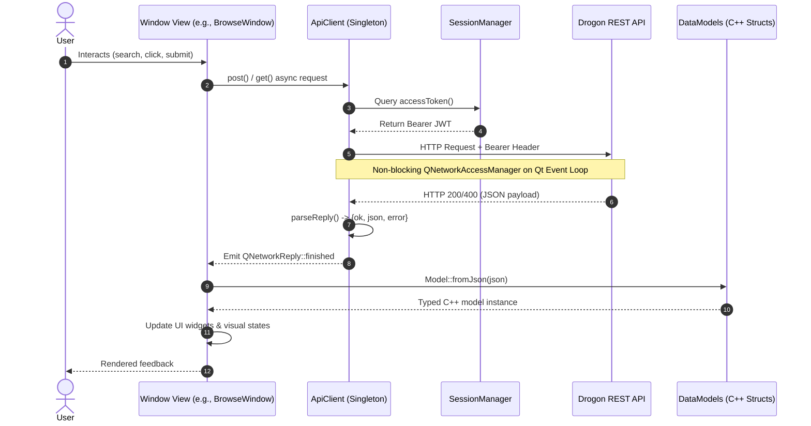
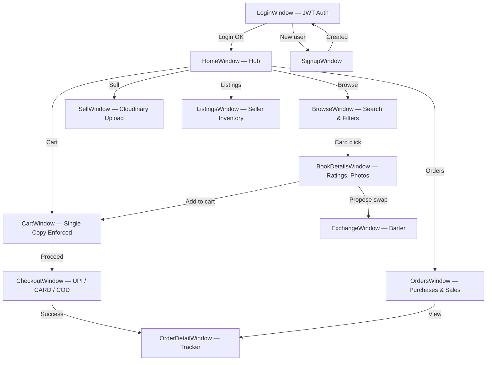

# BookBazzar — Qt 6 Desktop Client

[](https://en.wikipedia.org/wiki/C%2B%2B17)
[](https://www.qt.io/)
[](https://cmake.org/)

Native C++17 / Qt 6 Widgets desktop client for BookBazzar. Provides a full graphical interface for the peer-to-peer book marketplace and barter exchange network, communicating asynchronously with the [Drogon REST API backend](../backend/README.md).

---

## Architecture

BookBazzar follows a decoupled, **Layered Event-Driven Architecture** built on Qt's meta-object system and asynchronous signal-slot mechanism. Responsibilities are divided into distinct presentation, state, domain, and networking layers to maintain high testability and UI responsiveness.

### Layered Architecture Overview

```mermaid
graph TD
    subgraph UI ["Presentation Layer (Qt 6 Widgets)"]
        Screens["Window Views<br/>HomeWindow · BrowseWindow · BookDetailsWindow<br/>CartWindow · CheckoutWindow · OrderDetailWindow<br/>ExchangeWindow · ListingsWindow · OrdersWindow · SellWindow"]
        Dialogs["Dialogs & Alerts<br/>StyledMessageBox"]
    end

    subgraph Design ["Styling & Asset Infrastructure"]
        AppStyle["AppStyle<br/>Design Tokens · QSS Stylesheets · Color Palette"]
        ImageLoader["ImageLoader<br/>Async Pixmap Fetcher · In-Memory Cache"]
    end

    subgraph State ["State & Auth Layer"]
        SessionManager["SessionManager (Singleton)<br/>JWT Access Token · Expiration · User Profile<br/>Reactive sessionCleared Signal"]
    end

    subgraph Domain ["Domain Model Layer (C++17)"]
        DataModels["Typed Data Models (DataModels.h)<br/>BookModel · CartItemModel · OrderModel<br/>ExchangeProposalModel · ReviewModel · UserModel<br/>Static fromJson() / toJson() Serialization"]
    end

    subgraph Net ["Network & Transport Layer"]
        ApiClient["ApiClient (Singleton)<br/>QNetworkAccessManager Wrapper<br/>Bearer Header Injection · Multipart Upload · Error Envelope Parser"]
    end

    subgraph Remote ["Backend Services"]
        Backend["Drogon REST API Backend<br/>(http://127.0.0.1:8080)"]
    end

    Screens -->|Apply styles| AppStyle
    Screens -->|Fetch covers| ImageLoader
    Screens -->|Query / Mutate auth state| SessionManager
    Screens -->|Bind typed structs| DataModels
    Screens -->|Trigger async requests| ApiClient

    ImageLoader -->|Async HTTP GET| ApiClient
    ApiClient -->|Inject Bearer JWT| SessionManager
    ApiClient -->|HTTP / REST (JSON & Multipart)| Backend
    Backend -->|JSON Responses| ApiClient
    ApiClient -->|Parse JSON payload| DataModels
```

### Core Architectural Subsystems

| Subsystem | Key Class / Header | Design Pattern | Primary Responsibility |
| :--- | :--- | :--- | :--- |
| **Network Client** | [`ApiClient.h`](include/network/ApiClient.h) | Singleton | Non-blocking `QNetworkAccessManager` wrapper; handles Bearer JWT injection, base URL resolution, multipart uploads, and centralized response decoding via `parseReply()`. |
| **Authentication & Session** | [`SessionManager.h`](include/auth/SessionManager.h) | Singleton | Holds JWT token, user identity (`userId`, `username`), and token expiry; emits `sessionCleared` signal on logout/expiry to prompt re-authentication. |
| **Domain Modeling** | [`DataModels.h`](include/models/DataModels.h) | Value Objects | Pure C++ typed structs (`BookModel`, `CartItemModel`, `OrderModel`, `ExchangeProposalModel`, etc.) with strict JSON serialization/deserialization to guarantee type safety across UI screens. |
| **Design System** | [`AppStyle.h`](include/common/AppStyle.h) | Static Utility | Slate & Indigo color palette tokens, standardized QSS stylesheet generators (buttons, inputs, cards, navigation), and typography definitions. |
| **Asset Pipeline** | [`ImageLoader.h`](include/common/ImageLoader.h) | Cache / Proxy | Asynchronous network image downloader caching `QPixmap` instances in-memory to prevent redundant network transfers and eliminate UI thread blocking. |
| **Window Navigation** | [`include/windows/`](include/windows/) | Signal-Slot Coordinator | Centralized window flow enabling transitions across views without popup clutter or window leakage. |

### Asynchronous Request & Data Flow



---

## Tech Stack

| Component | Technology | Version |
| :--- | :--- | :--- |
| Language | C++ | ISO C++17 |
| GUI framework | Qt Widgets | 6.12.x |
| Network client | Qt Network — `QNetworkAccessManager` | Qt 6 |
| JSON | `QJsonDocument` / `QJsonObject` | Qt 6 |
| Async images | `QNetworkReply` + `QPixmap` | Qt 6 |
| Build system | CMake + Ninja | ≥ 3.16 |

---

## Directory Layout

```
frontend/
├── CMakeLists.txt                  # Qt6 + AUTOMOC/AUTOUIC build
│
├── include/
│   ├── auth/
│   │   └── SessionManager.h        # JWT lifecycle & user state — Singleton
│   ├── common/
│   │   ├── AppStyle.h              # Design system tokens & stylesheets
│   │   ├── ImageLoader.h           # Async pixmap cache
│   │   └── StyledMessageBox.h      # Styled alert/confirm dialogs
│   ├── models/
│   │   └── DataModels.h            # Typed models: Book, Cart, Order, Exchange, Review
│   ├── network/
│   │   └── ApiClient.h             # Async REST client — Singleton
│   └── windows/
│       ├── bookdetailswindow.h     # Book detail — cover, ratings, actions
│       ├── browsewindow.h          # Catalog — search, filters, sort, grid
│       ├── CartWindow.h            # Cart with ₹0 shipping & stale detection
│       ├── CheckoutWindow.h        # Checkout modal — UPI, CARD, COD
│       ├── ExchangeWindow.h        # Two-sided barter proposal & acceptance
│       ├── homewindow.h            # Marketplace hub — hero, categories, recent
│       ├── listingswindow.h        # Seller inventory management
│       ├── loginwindow.h           # Login screen
│       ├── OrderDetailWindow.h     # Delivery tracker & return request
│       ├── orderswindow.h          # Unified buyer/seller order history
│       ├── sellwindow.h            # Sell form + Cloudinary upload
│       └── signupwindow.h          # Registration screen
│
├── src/                            # Implementations matching include/
│   ├── main.cpp                    # App entry point & login launch
│   ├── auth/
│   │   └── SessionManager.cpp
│   ├── common/
│   │   ├── AppStyle.cpp
│   │   ├── ImageLoader.cpp
│   │   └── StyledMessageBox.cpp
│   ├── network/
│   │   └── ApiClient.cpp
│   └── windows/                    # All 12 window implementations
│
├── tests/                          # Qt Test suites (unit + GUI smoke)
└── ui/loginwindow.ui               # Qt Designer login layout
```

---

## UI Flow



---

## Screen Catalog

### Discovery
- **`HomeWindow`** — Hero banner, recent listings, category shortcuts (Academic, Fiction, Technology, Non-Fiction, Novels), search bar.
- **`BrowseWindow`** — Responsive card grid; real-time search by title, author, ISBN; price range, condition tags, sort options.
- **`BookDetailsWindow`** — High-res cover viewer, condition video preview, verified seller rating, `Add to Cart` and `Swap Book` actions.

### Purchasing
- **`CartWindow`** — Server-synced cart; stale item detection (`isAvailable: false`); subtotal with ₹0 delivery.
- **`CheckoutWindow`** — Address input with regex validation; payment selector (UPI, Card, COD); atomic double-buy prevention.
- **`OrderDetailWindow`** — Horizontal delivery tracker (`PLACED → DELIVERED`); tracking number; pre-shipment cancel; post-delivery return form.

### Selling
- **`SellWindow`** — Title, Author, ISBN, Price, Category, Condition fields; native Windows file picker; live Cloudinary CDN upload with thumbnail preview.
- **`ListingsWindow`** — Active inventory grid with edit and remove actions.

### Exchange
- **`ExchangeWindow`** — Dual-panel interface: own books vs. target book. Send proposals with notes; view incoming offers; accept/reject.

---

## Build & Run

### Prerequisites
- Windows 10/11 64-bit
- Qt 6.12.0 (or Qt 6.x) with Widgets and Network modules
- Visual Studio 2022 C++ Build Tools or MinGW 64-bit
- CMake ≥ 3.16 and Ninja

### Build via Qt Creator (Recommended)
1. Open Qt Creator → **Open File or Project** → select `frontend/CMakeLists.txt`.
2. Configure with your Qt 6 kit (e.g. `Desktop Qt 6.12.0 MSVC2022 64bit`).
3. `Ctrl+B` to build, `Ctrl+R` to run.

### Build via Command Line

```cmd
call "C:\Program Files (x86)\Microsoft Visual Studio\2022\BuildTools\VC\Auxiliary\Build\vcvarsall.bat" x64

cmake -S frontend -B frontend/build/Desktop_Qt_6_12_0_MSVC2022_64bit_Debug ^
      -G Ninja -DCMAKE_PREFIX_PATH="C:/Qt/6.12.0/msvc2022_64"

cmake --build frontend/build/Desktop_Qt_6_12_0_MSVC2022_64bit_Debug --target BookBazzar
```

### Run

```cmd
set PATH=C:\Qt\6.12.0\msvc2022_64\bin;%PATH%
.\frontend\build\Desktop_Qt_6_12_0_MSVC2022_64bit_Debug\BookBazzar.exe
```

## Configuration & Production Backend Integration

The backend REST API base URL is centralized in `frontend/include/network/ApiClient.h`.

### Resolution Priority

1. **Runtime Override**: `ApiClient::setBaseUrl("https://...")` programmatically at application startup.
2. **Environment Variable**: `BOOKBAZZAR_API_URL` (ideal for local testing against Render before packaging, or switching back to localhost).
3. **Compile-Time Default**: `ApiClient::kBaseUrl` (defaults to `kDefaultProductionUrl` in `ApiClient.h`).

```cpp
// In frontend/include/network/ApiClient.h:
static constexpr const char *kDefaultProductionUrl = "https://book-baazar.onrender.com";
static constexpr const char *kDefaultLocalUrl      = "http://127.0.0.1:8080";
static constexpr const char *kBaseUrl              = kDefaultProductionUrl;
```

### Pre-Packaging Testing with Production Render Backend

To test the desktop client against your live Render backend without recompiling:

```cmd
:: In Command Prompt:
set BOOKBAZZAR_API_URL=https://<your-render-service>.onrender.com
set PATH=C:\Qt\6.12.0\msvc2022_64\bin;%PATH%
.\frontend\build\Desktop_Qt_6_12_0_MSVC2022_64bit_Debug\BookBazzar.exe
```

Or in PowerShell:
```powershell
$env:BOOKBAZZAR_API_URL = "https://<your-render-service>.onrender.com"
$env:PATH = "C:\Qt\6.12.0\msvc2022_64\bin;" + $env:PATH
.\frontend\build\Desktop_Qt_6_12_0_MSVC2022_64bit_Debug\BookBazzar.exe
```

---

## Related

- [Backend README](../backend/README.md) — Drogon REST API reference and build guide
- [future.md](../future.md) — Production scaling roadmap