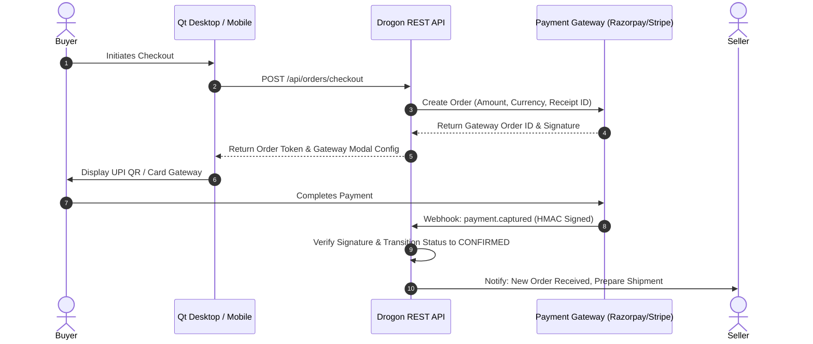
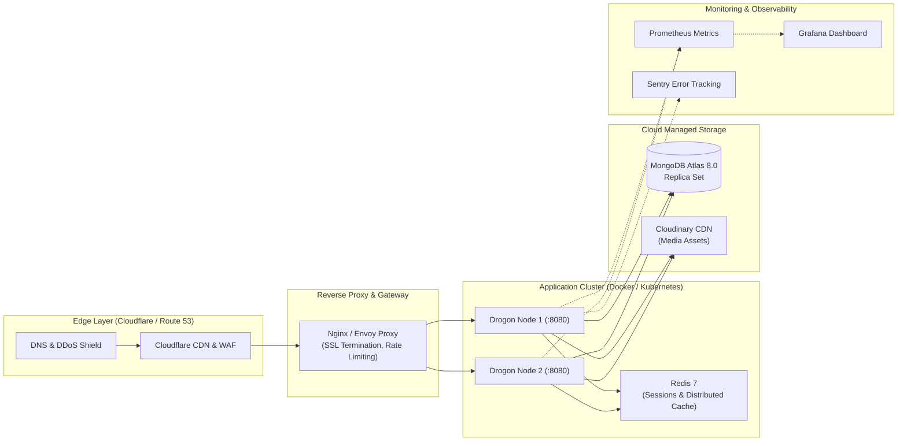

# 🚀 BookBazzar — Future Implementations Roadmap

> **Architectural Blueprint & Production Roadmap**  
> Key enhancements, real-world integrations, and user experience paradigms required to scale BookBazzar into a commercial-grade, peer-to-peer book marketplace and physical barter network.

---

## 📑 Table of Contents
1. [Real Payment Gateway Integration & Escrow Subsystem](#1-real-payment-gateway-integration--escrow-subsystem)
2. [Third-Party Logistics (3PL) & Automated Tracking](#2-third-party-logistics-3pl--automated-tracking)
3. [Real-Time WebSockets & In-App Event Streaming](#3-real-time-websockets--in-app-event-streaming)
4. [Peer-to-Peer Secure In-App Messaging & Negotiation](#4-peer-to-peer-secure-in-app-messaging--negotiation)
5. [Advanced Media Optimization & Video Streaming Pipeline](#5-advanced-media-optimization--video-streaming-pipeline)
6. [OAuth2 / Social Logins & Multi-Factor Authentication](#6-oauth2--social-logins--multi-factor-authentication)
7. [AI-Powered Computer Vision & Optical ISBN Scanning](#7-ai-powered-computer-vision--optical-isbn-scanning)
8. [Machine Learning Recommendation Engine](#8-machine-learning-recommendation-engine)
9. [Campus Meetup Zones & Geofenced Handover Verification](#9-campus-meetup-zones--geofenced-handover-verification)
10. [Cross-Platform Mobile Ecosystem (Flutter / React Native)](#10-cross-platform-mobile-ecosystem-flutter--react-native)
11. [Production Infrastructure, Microservices & Observability](#11-production-infrastructure-microservices--observability)

---

## 1. Real Payment Gateway Integration & Escrow Subsystem

### 🎯 Real-World Problem
Currently, payments are simulated via internal mocks (`UPI`, `CARD`, `COD`). In a live commercial deployment, users require reliable, PCI-DSS compliant transactions, instant UPI QR generation, credit/debit card processing, and trust-building escrow holdbacks.

### 🛠️ Target Architecture
- **Payment Gateway Providers**: **Razorpay** / **Stripe** / **Cashfree**.
- **Marketplace Escrow Holdback Pattern**:
  1. The buyer's payment is collected upon checkout and held in an escrow account.
  2. The seller is notified to pack and dispatch the book.
  3. Payout to the seller's verified bank account or UPI VPA is released **only after the buyer marks the package as received** (or 48 hours post courier confirmation without dispute).
- **Webhook Pipeline & Idempotency**:
  - Secure webhook endpoint (`/api/payments/webhook`) validating HMAC-SHA256 signatures.
  - Redis-backed distributed idempotency keys preventing duplicate crediting.
  - Automated webhook retry queues handling network partitions.
- **Automated Refund Engine**:
  - Pre-shipment cancellations trigger instant API refunds.
  - Approved returns initiate reverse payouts once the seller confirms receiving the physical item.

---

## 2. Third-Party Logistics (3PL) & Automated Tracking

### 🎯 Real-World Problem
Simulated tracking numbers (`DEMO_TRACK_...`) provide status progressions but do not correspond to actual courier pickups, delivery manifests, or live tracking.

### 🛠️ Target Architecture
- **Logistics Aggregators**: **Shiprocket**, **Delhivery**, or **BlueDart Express**.
- **Automated Air Waybill (AWB) Generation**:
  - When an order reaches `PACKED`, the backend automatically calls the 3PL API to book a courier pickup from the seller's address and generates a downloadable PDF shipping label with a scannable barcode.
- **Live Courier Tracking Webhooks**:
  - Replace manual seller status updates with asynchronous webhook callbacks from courier tracking infrastructure (`In Transit`, `Out for Delivery`, `Delivered`, `Failed Attempt`).
  - Send real-time WhatsApp and SMS tracking updates to buyers with estimated delivery timestamps.
- **Automated Weight & Dimensional Verification**:
  - Allow sellers to specify physical book dimensions and weight for automatic shipping rate calculation and dynamic courier selection (surface vs. air express).

---

## 3. Real-Time WebSockets & In-App Event Streaming

### 🎯 Real-World Problem
Currently, users rely on HTTP polling or window refreshes to observe order state changes, new incoming exchange requests, and review updates.

### 🛠️ Target Architecture
- **Drogon WebSocket Server** or dedicated **Socket.io / Go WebSocket Gateway**:
  - Persistent bidirectional full-duplex connection per authenticated user.
  - Channel subscription based on user ID: `user:{userId}:notifications`.
- **Live Event Catalog**:
  - `exchange.proposed`: Instant bell notification when a peer requests a barter swap.
  - `exchange.accepted`: Live alert with pickup/shipping instructions.
  - `order.status_changed`: Real-time tracker progression without refreshing the orders window.
  - `cart.item_sold`: Immediate toaster alert if an item in the user's cart is purchased by another user.
  - `price.drop`: Push notification if a book in the user's wishlist drops in price.

---

## 4. Peer-to-Peer Secure In-App Messaging & Negotiation

### 🎯 Real-World Problem
In book exchanges, users often need to clarify specific editions, highlight pencil markings, or arrange a mutually agreeable exchange location without sharing personal phone numbers.

### 🛠️ Target Architecture
- **End-to-End Encrypted or Moderated Peer Chat**:
  - Dedicated `/api/chat` endpoints with WebSocket streaming.
  - Contextual chat threads attached directly to an `exchangeId` or `bookId`.
- **Security & Privacy Controls**:
  - Automated regex and NLP filtering to prevent off-platform scamming, phishing URLs, and abusive language.
  - Anonymous proxy routing preventing leak of real personal email addresses or phone numbers.
  - Image attachment support for sharing close-up photos of book page condition.

---

## 5. Advanced Media Optimization & Video Streaming Pipeline

### 🎯 Real-World Problem
Direct high-resolution image and video uploads can consume substantial bandwidth and storage, leading to slow page renders on mobile or constrained networks.

### 🛠️ Target Architecture
- **Client-Side Pre-Processing**:
  - Automatic resizing and WebP/AVIF re-encoding in Qt/QImage prior to network transmission, reducing payload size by 75–85%.
- **Cloudinary Dynamic Transformations**:
  - Responsive image URLs (`f_auto,q_auto,w_400,c_fill` for book cards; `w_1200` for zoom view).
- **Adaptive Video Transcoding**:
  - Short 10–15 second condition walkthrough videos transcoded into **HLS (HTTP Live Streaming)** and MP4 presets.
  - Thumbnail sprite generation for hover scrub previews in the desktop client.

---

## 6. OAuth2 / Social Logins & Multi-Factor Authentication

### 🎯 Real-World Problem
Students and users expect fast, passwordless onboarding using existing institutional Google Workspace or social credentials.

### 🛠️ Target Architecture
- **OAuth 2.0 / OpenID Connect Providers**:
  - **Google Identity Services** (especially institutional `.edu` or college domain accounts).
  - **GitHub OAuth** (ideal for engineering/tech PBL cohorts).
  - **Apple Sign-In** for macOS and iOS clients.
- **Multi-Factor Authentication (MFA / 2FA)**:
  - Time-Based One-Time Password (TOTP) compatible with Google Authenticator / Microsoft Authenticator.
  - SMS/WhatsApp OTP verification for high-value transactions or password resets.

---

## 7. AI-Powered Computer Vision & Optical ISBN Scanning

### 🎯 Real-World Problem
Manually typing title, author, publisher, publication year, edition, and 13-digit ISBN is tedious and prone to typos, resulting in fragmented listings and poor search relevancy.

### 🛠️ Target Architecture
- **Barcode & ISBN Scanner**:
  - Desktop webcam / mobile camera integration using **ZXing-C++** or Google ML Kit.
  - Instant barcode scan fetches canonical metadata from **Open Library API** or **Google Books API**, pre-populating all book details in < 500ms.
- **Automated Book Cover Quality & Condition Assessment**:
  - On-device or cloud computer vision model assessing blur, glare, and orientation.
  - Computer vision classifier verifying whether the captured image contains a book cover before accepting the upload.

---

## 8. Machine Learning Recommendation Engine

### 🎯 Real-World Problem
Static date-sorted feeds display books chronologically rather than catering to individual user academic curricula, reading habits, or wishlists.

### 🛠️ Target Architecture
- **Hybrid Recommendation Pipeline**:
  - **Content-Based Filtering**: Recommends books sharing categories, authors, academic semesters, or syllabus subjects.
  - **Collaborative Filtering**: Suggests items based on co-purchase and co-exchange patterns ("Students who exchanged *Database Systems* also looked at *Operating Concepts*").
- **Vector Search & Semantic Discovery**:
  - Book descriptions indexed with dense vector embeddings (e.g., embeddings generated via sentence-transformers).
  - Semantic natural language search powered by MongoDB Atlas Vector Search ("Find introductory calculus books with good worked examples").

---

## 9. Campus Meetup Zones & Geofenced Handover Verification

### 🎯 Real-World Problem
Students living on the same college campus or in the same neighborhood should not have to pay shipping fees or wait 3–5 business days for a courier.

### 🛠️ Target Architecture
- **Campus Zero-Cost Handover Protocol**:
  - Users select an institutional campus / library pickup hub during checkout or exchange proposal.
- **Cryptographic QR Code Handover Verification**:
  - The seller receives an encrypted dynamic QR code on their device.
  - When meeting in person, the buyer scans the seller's QR code.
  - Both devices submit cryptographic proof of proximity to `/api/exchange/verify-handover`, immediately completing the transaction and transferring ownership with zero shipping overhead.

---

## 10. Cross-Platform Mobile Ecosystem (Flutter / React Native)

### 🎯 Real-World Problem
A desktop-only interface limits on-the-go browsing, physical camera scanning, and instant push notifications.

### 🛠️ Target Architecture
- **Mobile Client**:
  - Developed using **Flutter** or **React Native**, directly consuming the clean Drogon REST API endpoints (`/api/*`).
  - Native integration with camera hardware for barcode scanning and video walkthrough recording.
  - Firebase Cloud Messaging (FCM) / Apple Push Notification service (APNs) for instant mobile alerts.

---

## 11. Production Infrastructure, Microservices & Observability

### 🎯 Real-World Problem
Publishing online requires high availability, automated TLS certificate renewal, load balancing, defense-in-depth security, and real-time operational telemetry.

### 🛠️ Target Architecture

### Key Production Enhancements:
1. **Containerization & CI/CD**:
   - Multi-stage `Dockerfile` producing minimal Alpine/Debian slim runtime containers.
   - GitHub Actions pipeline automating linting, unit tests, QTest execution, and Docker container publishing.
2. **Rate Limiting & Anti-Scraping**:
   - Token bucket rate limiting in Nginx/Drogon to mitigate brute force login attempts and catalog scraping (max 60 requests/minute per IP on search, 5/minute on auth).
3. **Observability & Health Checks**:
   - `/api/health` endpoint returning database latency and system uptime.
   - Prometheus exporter exposing HTTP request rate, p99 latency percentiles, and memory utilization.
   - Sentry crash reporting integration for unhandled runtime exceptions.

---

*Authored for the BookBazzar Production Readiness Assessment.*
