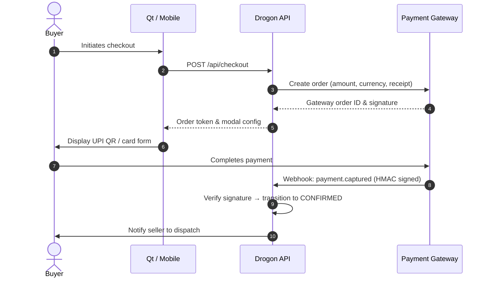
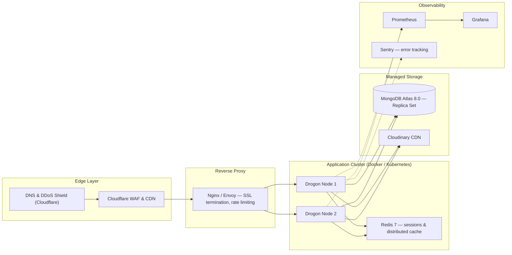

# BookBazzar — Production Roadmap

Architectural milestones required to scale BookBazzar from a demonstration-grade C++ PBL project into a commercially deployable, multi-tenant, cloud-native peer-to-peer book marketplace.

---

## 1. Real Payment Gateway & Escrow

Replace the demo payment simulation with PCI-DSS compliant processing.

- **Gateway**: Razorpay / Stripe / Cashfree for UPI QR, credit/debit card, and netbanking.
- **Escrow holdback**: Buyer funds held until delivery confirmation (or 48h post-courier confirmation without dispute), then released to seller's verified UPI VPA or bank account.
- **Webhook pipeline**: `/api/payments/webhook` with HMAC-SHA256 signature validation; Redis-backed idempotency keys preventing duplicate credit; automatic retry queues.
- **Refund engine**: Pre-shipment cancellations trigger instant API refunds; approved returns initiate reverse payouts.

---

## 2. Third-Party Logistics (3PL) & Live Tracking

Replace simulated tracking IDs with real courier integration.

- **Aggregators**: Shiprocket, Delhivery, or BlueDart Express.
- **AWB generation**: On `PACKED`, auto-book courier pickup from seller's address; generate downloadable PDF shipping label with barcode.
- **Live tracking webhooks**: Replace seller status updates with async callbacks (`In Transit`, `Out for Delivery`, `Delivered`, `Failed Attempt`); push WhatsApp/SMS updates with ETA.
- **Rate calculation**: Seller-entered book dimensions and weight → dynamic courier selection (surface vs. air express).

---

## 3. Real-Time WebSocket Notifications

Replace HTTP polling with a persistent bidirectional event channel.

- **Transport**: Drogon WebSocket server or a dedicated Socket.io/Go WebSocket gateway.
- **Channels**: Per-user subscription `user:{userId}:notifications`.
- **Events**: `exchange.proposed`, `exchange.accepted`, `order.status_changed`, `cart.item_sold`, `price.drop`.

---

## 4. In-App Peer-to-Peer Messaging

Secure contextual chat for barter negotiation without sharing personal contact details.

- Dedicated `/api/chat` endpoints with WebSocket streaming; threads scoped to `exchangeId` or `bookId`.
- Automated regex/NLP filtering for phishing URLs and abusive content.
- Anonymous routing — real email/phone never exposed.
- Image attachment support for sharing close-up book condition photos.

---

## 5. Advanced Media Pipeline

Optimize upload size and delivery quality.

- **Client-side pre-processing**: Qt `QImage` resize + WebP/AVIF re-encode before upload (75–85% payload reduction).
- **Cloudinary transformations**: Responsive URLs (`f_auto,q_auto,w_400` for cards; `w_1200` for detail view).
- **Adaptive video**: Condition walkthrough clips transcoded to HLS + MP4 presets; thumbnail sprite for hover scrub.

---

## 6. OAuth2 & Multi-Factor Authentication

Passwordless onboarding and stronger account security.

- **OAuth 2.0 / OIDC providers**: Google Identity Services (institutional `.edu` domains), GitHub OAuth, Apple Sign-In.
- **MFA / 2FA**: TOTP (Google Authenticator / Microsoft Authenticator); SMS/WhatsApp OTP for high-value transactions or password resets.

---

## 7. Computer Vision & ISBN Barcode Scanning

Instant book metadata extraction to eliminate manual data entry.

- **Scanner**: Desktop webcam / mobile camera via ZXing-C++ or Google ML Kit; auto-fetch title, author, publisher, and edition from Open Library API or Google Books API in < 500ms.
- **Quality gate**: On-device or cloud CV model rejecting blurry, glare-affected, or non-book-cover uploads before Cloudinary ingestion.

---

## 8. Machine Learning Recommendation Engine

Personalized discovery beyond chronological feeds.

- **Content-based filtering**: Recommendations by shared category, author, academic subject, or syllabus.
- **Collaborative filtering**: Co-purchase and co-exchange signals ("Students who exchanged *Database Systems* also viewed *Operating Concepts*").
- **Semantic search**: Dense vector embeddings indexed in MongoDB Atlas Vector Search for natural-language queries ("introductory calculus with worked examples").

---

## 9. Campus Meetup Zones & Zero-Cost Handover

Eliminate shipping fees for same-campus peers.

- Users select a campus / library pickup hub during checkout or exchange proposal.
- **Cryptographic QR verification**: Seller generates an encrypted dynamic QR; buyer scans it in-person; both devices submit proof of proximity to `/api/exchange/verify-handover` → instant atomic ownership transfer with zero shipping cost.

---

## 10. Cross-Platform Mobile Client

Extend the platform beyond desktop.

- **Framework**: Flutter or React Native consuming the existing Drogon REST API (`/api/*`) without backend changes.
- Native camera integration for barcode scanning and video walkthroughs.
- Firebase Cloud Messaging (FCM) / Apple Push Notification service (APNs) for instant mobile alerts.

---

## 11. Production Infrastructure & Observability

Key enhancements:

- **Containerisation & CI/CD**: Multi-stage `Dockerfile` (Alpine/Debian slim runtime); GitHub Actions pipeline for linting, tests, and Docker image publishing.
- **Rate limiting**: Token-bucket limiting in Nginx/Drogon — 60 req/min per IP on search, 5 req/min on auth endpoints.
- **Health & metrics**: `/api/health` returning DB latency and uptime; Prometheus exporter exposing request rate, p99 latency, and memory utilisation; Sentry crash reporting.
- **Redis session caching**: Distributed refresh token storage replacing MongoDB for sub-millisecond session lookups.

---

*See [backend/README.md](backend/README.md) for current implementation and [frontend/README.md](frontend/README.md) for the desktop client.*